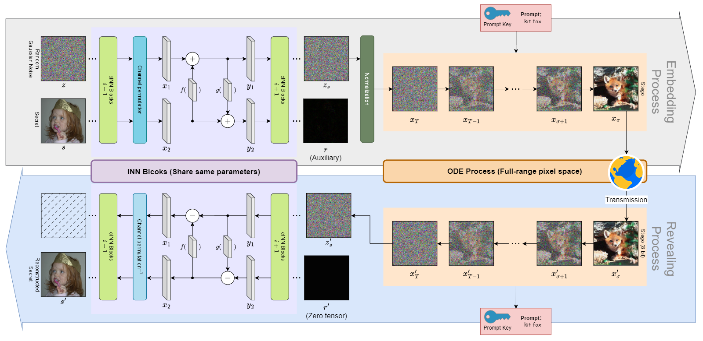

<h1 align="center">One Secret, Many Faces: Pixel-Space Generative Image Steganography for Diverse Dense Carriers</h1>

Official Code Implementation.
# Abstract
The same secret can be used to generate diverse carriers, and the recipient can extract the secret image from the stego carrier without obtaining the private key.

In this open-source repository, we provide the code for model definitions and modules, through which you can retrain on different databases.

# Model Structure
Our model is composed of reversible neural networks and an ODE integrator, as shown in the figure.


# Train
Retrain the model using the provided train.py script.

```bash
python train.py --epochs 100 --save --device cuda:0
```

# Valid
